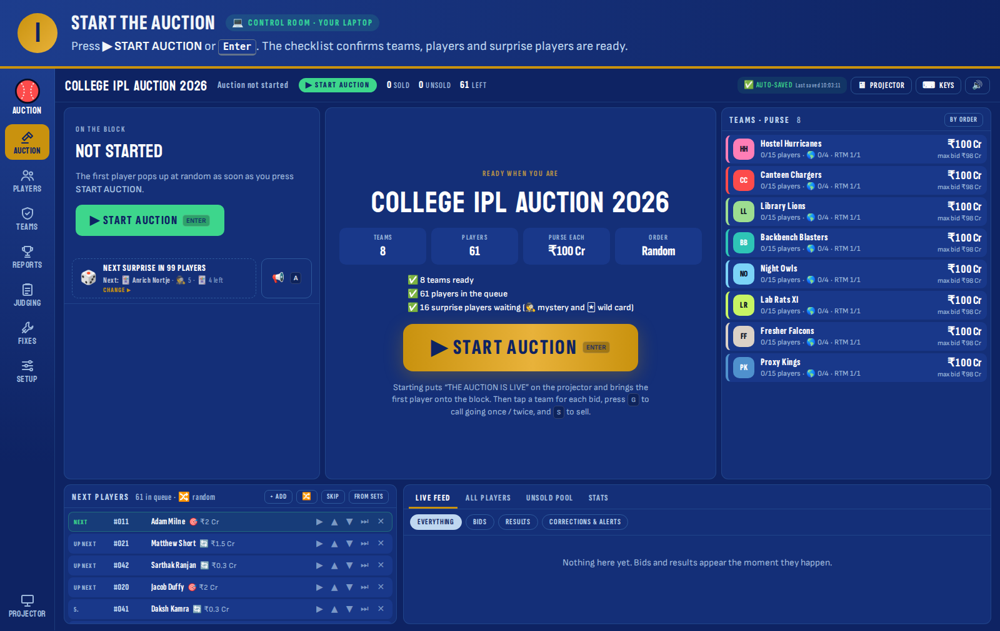
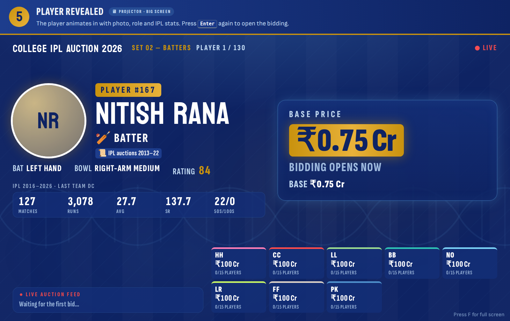
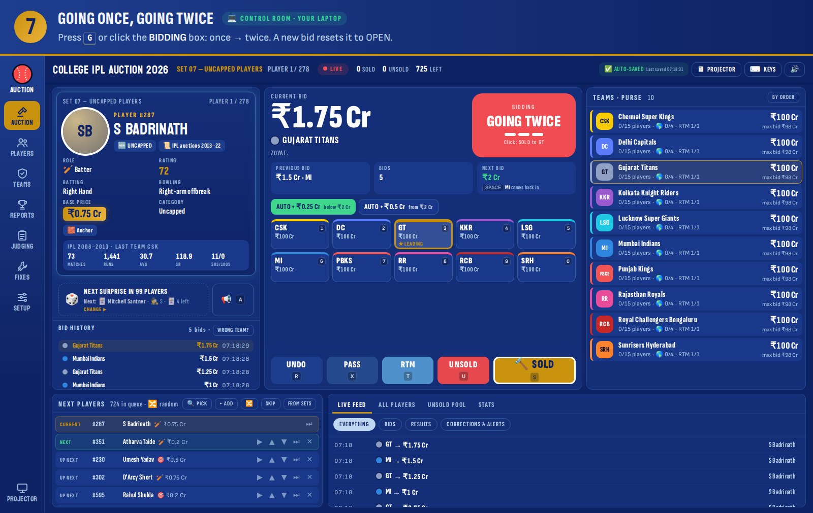
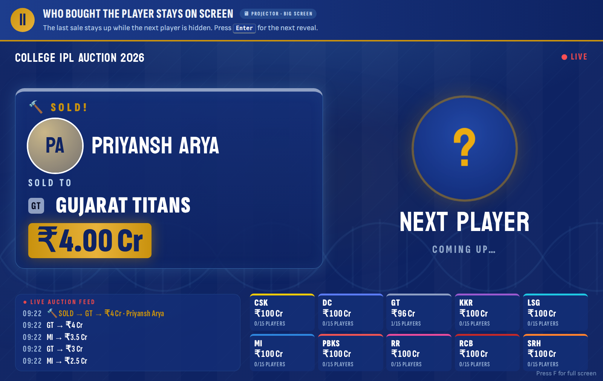

# AuctionManagement

A control room for running a college IPL-style player auction from one laptop. It is a single HTML file: no server, no install.

**Live site: https://auctionmanagement.vercel.app/** (Vercel, redeploys on every push). Or **open `index.html` in Chrome, Edge or Firefox.** New to running the auction? Read the 3-page [Auctioneer's guide (PDF)](docs/Auctioneer-Guide.pdf). It starts with a practice auction: 8 made-up college teams bidding for real IPL players, about 40 players in. Clear it with the **SAMPLE DATA** button, or in **Setup → Backup & reset**.

## Screenshots

A full demo run, step by step: your laptop (control room) and the big screen (projector). All 13 steps are also in one PDF: [Auction-Demo-Screenshots.pdf](docs/Auction-Demo-Screenshots.pdf).

| Control room | Projector |
| --- | --- |
|  |  |
|  |  |

All steps:

1. [Start the auction](docs/screenshots/01-start.png)
2. [Projector before the start](docs/screenshots/02-projector-starts-soon.png)
3. [Next player on your screen only](docs/screenshots/03-control-show-player.png)
4. [Audience waits: player hidden](docs/screenshots/04-projector-first-player-hidden.png)
5. [Player revealed on the projector](docs/screenshots/05-projector-player-revealed.png)
6. [Taking bids](docs/screenshots/06-control-bidding.png)
7. [Going once, going twice](docs/screenshots/07-control-going-twice.png)
8. [The room sees the call](docs/screenshots/08-projector-going-twice.png)
9. [Close and confirm the sale](docs/screenshots/09-control-confirm-sale.png)
10. [SOLD! on the projector](docs/screenshots/10-projector-sold.png)
11. [Who bought the player, next one hidden](docs/screenshots/11-projector-sold-to-next-hidden.png)
12. [Mystery and wild card picker](docs/screenshots/12-control-surprise-picker.png)
13. [Setup: player order](docs/screenshots/13-setup-order.png)

## What it does

- **Real IPL players of 2013–2026 (741)**: the pool starts with the 77 players sold at the real IPL 2026 auction ([IPL Auction Dataset 2026](https://www.kaggle.com/datasets/sunnyyadav754/ipl-auction-dataset-2026)), with each player's base price, capped / uncapped, overseas status and the team and price they went for (shown as an “IPL 2026” badge). Ratings follow the 2026 price and the 10 biggest buys form the marquee set. After them, best rated first, come 488 players sold at the IPL auctions of 2013–2022 (marked “IPL auctions 2013–22”) and 176 more players who have played an IPL season since 2013, from AB de Villiers, Chris Gayle and Lasith Malinga to today's stars like Virat Kohli and Rohit Sharma. Only players from 2013 to 2026 are included: players whose last IPL season was before 2013 are left out. All 741 are loaded by default (725 in the main auction plus 8 mystery players and 8 wild cards); for a shorter auction, lower the number in Setup and the best rated stay in. Every player with IPL matches gets their role, batting and bowling style, career stats and special-ability tags from the 2008–2026 match data of the [IPL-DATASET](https://github.com/ritesh-ojha/IPL-DATASET). Players marked **❓ Check role** have no matches in the data and only a guessed role; check it on the Players page. Load them in **Setup → Players** (set how many go into the main auction), or import your own list.
- **Start Auction button**: a new or reset auction waits on a start screen that shows the teams, players, purse, player order and a readiness checklist. Press **▶ START AUCTION** (or `Enter`, or the green button in the top bar) to put “THE AUCTION IS LIVE” on the projector and bring the first player onto the block. Until then, the projector shows “The auction starts soon”.
- **Next player kept hidden on the projector**: after each sale the projector shows who bought the player (photo, team and price) while the next player stays hidden behind a "Next player coming up" card. Press `Enter` (or **SHOW PLAYER ON PROJECTOR**) to reveal them, and `Enter` again to open the bidding. Turn it off in **Setup → Sets & order**.
- **Control room**: the player on the block, current bid, one-click team bids, SOLD / UNSOLD / UNDO / PASS / RTM, team purses, the next-players queue and a live feed, all on one screen.
- **Manual bid close**: there is no countdown timer. The auctioneer closes each player by hand: click the **BIDDING** box (or press `G`) to call *going once*, then *going twice*, then close. Closing sells to the highest bidder, or marks the player unsold if nobody bid. Any new bid reopens the bidding. The projector shows each call.
- **Choose your own player list**: in **Setup → Players → ✅ CHOOSE PLAYERS**, set how many players to keep, fill the list with the best rated or at random (filter by role, by source — IPL 2026 auction, auctions 2013–22, other IPL players — or Indian / overseas to build it role by role, say 40 batters then 40 bowlers), and tick or untick anyone. **LOAD** puts exactly those players in the auction, with the mystery players and wild cards drawn from your list. The ticked list is remembered in the browser.
- **Pick the next player yourself**: press `K` (or **🔍 Pick** above the queue) to search the waiting players by name, role or set, sort them by rating or base price, and put one on the block; **🎲 RANDOM PLAYER** brings a random one. It works in every order mode. Choose **The auctioneer picks each player** in **Setup → Sets & order** and the block waits for your pick (`K`) or a random one (`N`) after every result, while mystery players and wild cards still pop in by themselves.
- **Random order**: players pop up at random instead of one after another. In **Setup → Sets & order** you can switch to random within each set, or back to the fixed set-by-set order. The 🔀 button in the control room reshuffles the queue. While the order is random, the projector doesn't show who is coming up.
- **Surprises**: every few players, at random, a mystery player or a wild card pops into the auction on its own. Mystery players get clues written from their own IPL stats; the clues and the reveal can run by themselves. Set how often surprises happen, and how many of each, in **Setup → Surprises**.
- **Handler control over surprises**: the 🎲 box in the control room shows only the auctioneer who pops in next. Click it to pick a different mystery or wild card player, turn any available player into one, take a fresh random pick, or **pop one in now**. While a surprise player is on the block and nobody has bid yet, the same box swaps them for someone else, and the first player goes back to the surprise pool.
- **Budget safety**: blocks bids over a team's purse or past its squad, overseas or role limits, and warns about low purses and unmet role minimums.
- **Right to Match**, with an optional final raise. Teams named after an IPL franchise (for example CSK or Mumbai Indians) get the RTM for that franchise's last players.
- **Event logo**: upload your college or event logo in **Setup → Event & teams** and it shows on the projector (top bar and the “starts soon” screen). Use a logo you have permission to use.
- **Projector view**: press `V`, or open the page in a second window with `#projector` at the end of the address.
- **Corrections**: change a team or price, re-auction, send to the unsold pool, adjust purses, restore an earlier state. Nothing is deleted from the history.
- **Reports and judging**: team reports, auction statistics, a judging panel out of 100, and fun awards.
- **Exports**: CSV, Excel and PDF. Excel and PDF need internet the first time.

## Keyboard shortcuts

| Key | Action |
| --- | --- |
| `Space` | Next bid (the other team in a bidding war comes back in) |
| `1`–`9`, `0` | Bid for teams 1–10 |
| `Shift+1`–`5` | Bid for teams 11–15 |
| `G` | Going once → going twice → close the bidding |
| `S` / `U` | Sold / unsold |
| `R` | Undo |
| `N` / `P` | Next / previous player (`N` brings a random one when you pick players yourself) |
| `K` | Pick the next player yourself |
| `M` / `Shift+M` | Mystery player on the block: next clue / reveal now |
| `T` | Right to Match |
| `C` | Custom bid |
| `X` | Pass |
| `A` | Breaking news alert |
| `V` / `F` | Projector view / full screen |
| `Enter` | Start the auction, show the next player on the projector, open the bidding, or confirm |
| `Esc` | Cancel |

## Saving

Every action saves instantly in the browser the auction runs in, and the auction comes back after a refresh or a crash. Everything (the auction, the undo history, saved photos and photo lookups) is kept in the browser's IndexedDB database, which has room for hundreds of MB, not the 5 MB of localStorage; data from older versions is moved over automatically, and the app asks the browser to keep it permanently. **Setup → Backup & reset** shows how much space it uses. If a browser blocks IndexedDB (some private windows), the app falls back to localStorage and says so. That storage belongs to one browser on one laptop, so use **Export backup** (in Setup → Backup & reset, or Reports) before the event and at breaks. **Restore backup** loads it on any machine.

## Player photos

Photos need internet. The app tries the dataset's image link first, then a photo from Wikipedia found by the player's name; players with neither show their initials. Before the event, open **Players** (or **Setup → Players**) and press **📷 SAVE PHOTOS OFFLINE** once while online. Every photo it finds is saved inside the auction, so it shows without internet and is included in **Export backup**. Add any missing photos with **BULK PHOTOS** or **Edit player**.

## Importing your own players

Use a CSV or Excel file with a header row. Recognised columns: Player ID, Name, Role, Batting, Bowling, Rating, Base Price, Category, Overseas, Tags, Mystery, Wild Card, Set, RTM Team, Clues, Photo URL. Separate several tags or clues with `|`. **Players → CSV template** downloads an example file.

## Data credits

All the source datasets are in [`data/`](data/), with [`data/player-pool.csv`](data/player-pool.csv) (the whole 741-player pool as a spreadsheet you can edit and import back) and the steps to rebuild the pool.


The auction player list (names, nationality, base price, winning bid, team, capped / uncapped) comes from the [IPL Auction Dataset 2026](https://www.kaggle.com/datasets/sunnyyadav754/ipl-auction-dataset-2026) by Sunny Yadav on Kaggle; check its page for the licence before reusing it. Ratings are calculated from the winning bid. Roles, career stats, photo links and tags for players with IPL history come from the [IPL-DATASET](https://github.com/ritesh-ojha/IPL-DATASET) by Ritesh Ojha (2024 player details, match line-ups and ball-by-ball data). The players from the IPL auctions of 2013–2022 come from the player list in an EDA notebook of the IPL Player Auction Dataset (from start to now) on Kaggle; that notebook only keeps the names, so their roles, overseas status and ratings come from the IPL-DATASET where they appear and were otherwise added by hand (`tools/add_past_players.py`). Career stats, batting hand, bowling style and roles for players without them, and the 176 other IPL players of 2013–2026, come from the IPL-DATASET match files (ball-by-ball data for 2008–2026, `tools/ipl_stats.py` and `tools/add_ipl_players.py`); their ratings are worked out from career runs, wickets, strike rate, economy and matches played, and their overseas status was added by hand. Roles for some 2026 newcomers were also added by hand; players without a confirmed role are marked “❓ Check role”.

The dataset is published under the MIT License:

```
The MIT License (MIT)

Copyright (c) 2022 Ritesh Ojha

Permission is hereby granted, free of charge, to any person obtaining a copy
of this software and associated documentation files (the "Software"), to deal
in the Software without restriction, including without limitation the rights
to use, copy, modify, merge, publish, distribute, sublicense, and/or sell
copies of the Software, and to permit persons to whom the Software is
furnished to do so, subject to the following conditions:

The above copyright notice and this permission notice shall be included in all
copies or substantial portions of the Software.

THE SOFTWARE IS PROVIDED "AS IS", WITHOUT WARRANTY OF ANY KIND, EXPRESS OR
IMPLIED, INCLUDING BUT NOT LIMITED TO THE WARRANTIES OF MERCHANTABILITY,
FITNESS FOR A PARTICULAR PURPOSE AND NONINFRINGEMENT. IN NO EVENT SHALL THE
AUTHORS OR COPYRIGHT HOLDERS BE LIABLE FOR ANY CLAIM, DAMAGES OR OTHER
LIABILITY, WHETHER IN AN ACTION OF CONTRACT, TORT OR OTHERWISE, ARISING FROM,
OUT OF OR IN CONNECTION WITH THE SOFTWARE OR THE USE OR OTHER DEALINGS IN THE
SOFTWARE.
```
